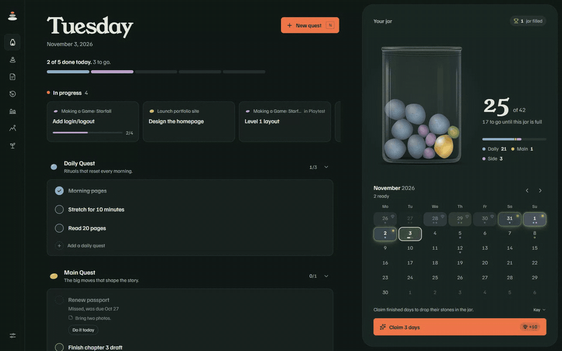
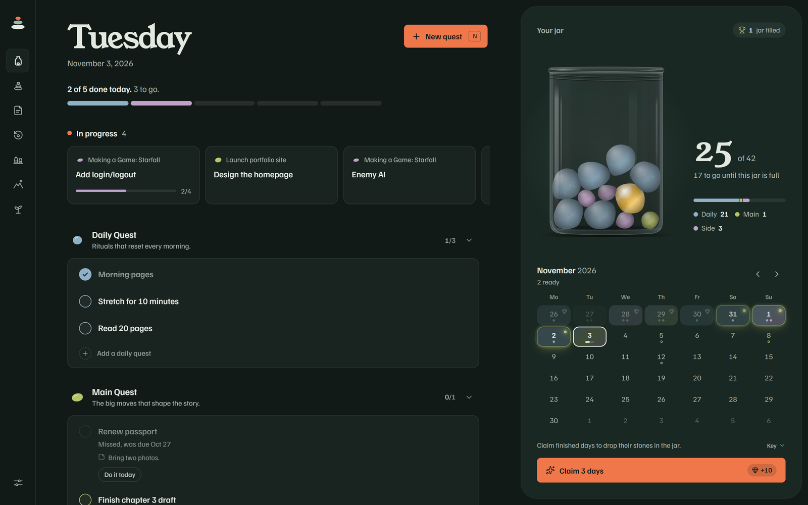
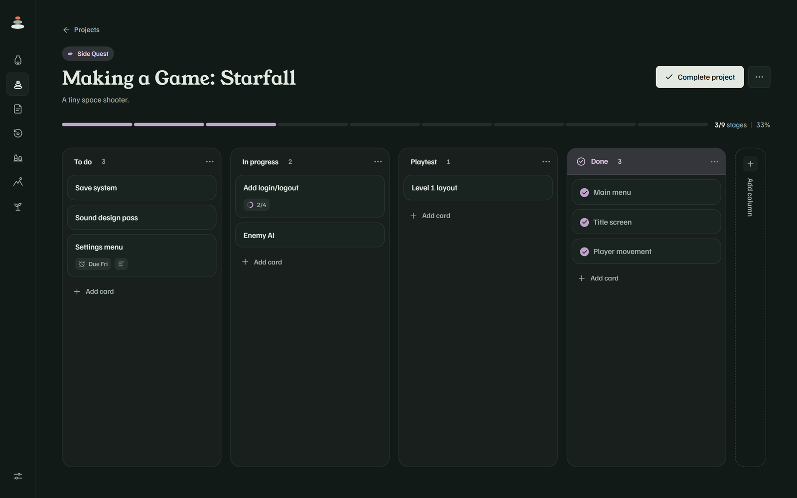
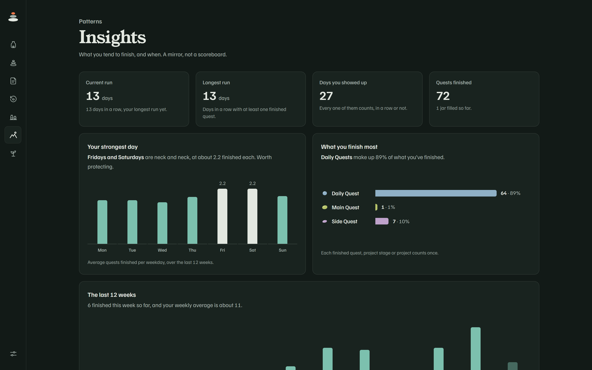
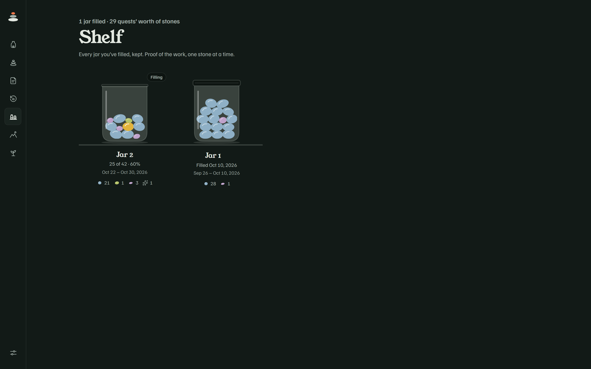
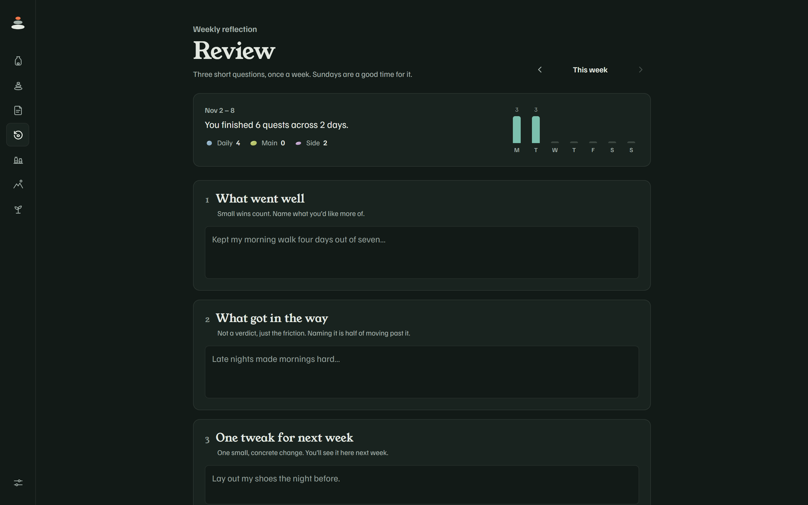
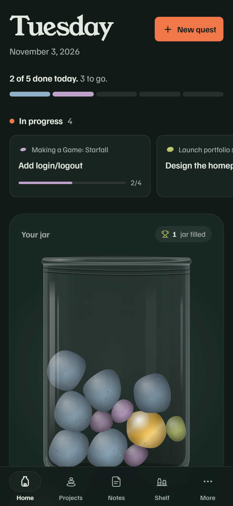
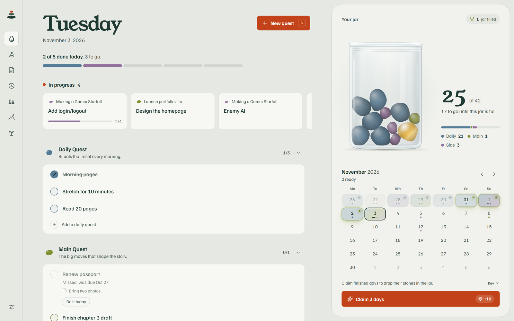

<div align="center">


# Pebblework

**Small wins, stacked.** A calm, local-first tracker for your goals and tasks.<br/>
Finish what you set out to do each day, claim it, and watch the stones pile up in your jar.



</div>

---

## Why a jar?

A checkbox turning green is easy to forget. A jar that visibly fills up is not. Pebblework is built around the
two-jar habit method: every day you finish adds stones to a jar you can see, colored by the kind of work you did.
When the jar fills, it gets sealed and goes on your shelf, so you keep a record of what you've done instead of just starting over.

The rest of the app follows a few rules:

- **Small, visible wins.** Progress is physical and immediate, not a number buried in a report.
- **Honest but forgiving.** You can only complete a quest on the day it's due, but you can claim earned days whenever you next open the app. One click catches up a whole week.
- **No guilt.** Missed quests are labeled plainly and can be moved to today. Nothing turns red.
- **Identity over output.** Link quests to the person you're trying to become. Each one you finish counts toward that.

## Screenshots

<table>
  <tr>
    <td colspan="2"></td>
  </tr>
  <tr>
    <td colspan="2" align="center"><sub>Home: today's quests on the left, your jar and quest calendar on the right</sub></td>
  </tr>
  <tr>
    <td></td>
    <td></td>
  </tr>
  <tr>
    <td align="center"><sub>Project board</sub></td>
    <td align="center"><sub>Insights</sub></td>
  </tr>
  <tr>
    <td></td>
    <td></td>
  </tr>
  <tr>
    <td align="center"><sub>Shelf of filled jars</sub></td>
    <td align="center"><sub>Weekly review</sub></td>
  </tr>
</table>

<p align="center">
  <br/>
  <sub>Responsive down to phone size, with a bottom tab bar</sub>
</p>

<details>
<summary>Prefer light mode?</summary>
<br/>

</details>

## Features

| | |
|---|---|
| **Quests** | Three kinds, each with its own color and stone: **Daily** (rituals on the days you pick: every day, weekdays, or Mon/Wed/Fri), **Main** (the big moves), and **Side** (errands, if time allows). Press <kbd>N</kbd> anywhere on Home to add one. |
| **Plan tomorrow / today** | From 6 PM, Home asks you to plan **tomorrow**: pick up to 3 quests or loose ends and give each a start time, with an optional "if it slips, I'll…" fallback, so the morning starts with something to look forward to. Once it's planned, a small Tomorrow card shows what's waiting. The next morning, Home shows that plan for a quick review (**Looks good** or **Edit**) before the day starts. If you didn't plan the night before, the morning asks about today instead. One sheet covers both days (a Today / Tomorrow switch). Planned quests lead the Today list by time, with a **Next up** marker and a one-tap **Move to…** once a time has passed. On a new week, a new month, or after a few quiet days, the prompt opens with a fresh start. Planning earns no stones; doing does. |
| **Quest calendar** | A month grid that marks each day as pending, ready to claim, or claimed. One **Claim** button sweeps up every finished day at once. Heavier days drop more stones, like a GitHub contribution graph. |
| **The jar** | A physics-simulated jar (matter-js) where stones drop, bounce and settle. Its capacity scales with your quest load. Now and then a stone comes out golden. A jar that replaces a sealed one starts with 3 stones already in it. |
| **Backup reminder** | When your last backup is a month old, Home suggests downloading one. "Later" snoozes it for two weeks. |
| **Projects** | Break bigger goals into Kanban boards with draggable columns, cards and subtasks. Every stage you finish earns a stone. |
| **Shelf** | Filled jars get sealed, labeled with their date range and kept, along with a breakdown by quest type. |
| **Insights** | Current and longest runs (one missed day won't break a run; two in a row will), days you showed up, your strongest weekday, what you finish most, and the last 12 weeks. |
| **Weekly review** | Three short prompts: what went well, what got in the way, and one tweak for next week. |
| **Identity** | Write "who I'm becoming" statements and link quests to them. Finishing a linked quest shows "+1 vote for" that statement. |
| **Notes** | Plans, thoughts and what got in the way, all in one place. |
| **Loose ends** | Quick, one-off reminders on Home that stay outside the quest and reward loop. |
| **Themes** | Light, dark, or follow the system. The jar canvas follows the theme too. |
| **Installable** | A PWA, so you can add it to your home screen or dock and use it offline. |

## Your data stays yours

Pebblework has no backend and no account. Everything lives in your browser's IndexedDB (via [Dexie](https://dexie.org)).
Browsers can clear site data, so **Settings → Your data** lets you download a backup file and restore from one.

## Getting started

Requires Node.js 20.19+ or 22.12+.

```bash
git clone https://github.com/aeronjay/pebblework.git
cd pebblework
npm install
npm run dev
```

Then open the URL Vite prints (usually http://localhost:5173).

### Demo data

In dev mode you can fill the app with realistic history:

| URL | What you get |
|---|---|
| `/?seed=1` | A jar about 60% full, a filled jar on the shelf, projects, and a few days ready to claim |
| `/?seed=full` | A jar about 92% full with enough ready days to overflow it, so you can see a jar get sealed |

The seed data is built with the real repository and claim functions using backdated timestamps, so it follows the same rules as real use.
The seed code is stripped from production builds.

> [!WARNING]
> Seeding **wipes everything** in that browser's local database before adding the demo data. If you have real data on `localhost`, download a backup from Settings first.

## Scripts

| Command | Description |
|---|---|
| `npm run dev` | Start the Vite dev server |
| `npm run build` | Type-check and build for production |
| `npm run preview` | Preview the production build |
| `npm test` | Run the test suite (Vitest + fake-indexeddb) |
| `npm run lint` | Lint with oxlint |

## Tech stack

- **[React 19](https://react.dev)** + **TypeScript**, bundled with **[Vite](https://vite.dev)**
- **[Tailwind CSS v4](https://tailwindcss.com)** with theme tokens for light and dark
- **[Dexie](https://dexie.org)** (IndexedDB) for local-first storage, with live queries
- **[matter-js](https://brm.io/matter-js/)** for the jar's 2D physics
- **[Motion](https://motion.dev)** and **canvas-confetti** for animation
- **[dnd-kit](https://dndkit.com)** for drag-and-drop boards
- **[Zustand](https://zustand.docs.pmnd.rs)**, **date-fns**, **lucide-react**
- **vite-plugin-pwa** for offline support and installing

## Project structure

```
src/
├── app/          # Nav, hash router, theme, shared hooks
├── db/           # Dexie schema, types, backup/restore
├── features/     # One folder per domain
│   ├── quests/      # Daily/Main/Side quests, completion and claiming
│   ├── calendar/    # Quest calendar and the Claim button
│   ├── jar/         # Physics jar: simulation, drawing, stage
│   ├── marbles/     # Stone rarity and weight rules
│   ├── projects/    # Project cards and list
│   ├── board/       # Kanban boards for projects
│   ├── focus/       # "In progress" strip
│   ├── shelf/       # Filled jars
│   ├── insights/    # Stats and charts
│   ├── review/      # Weekly review
│   ├── identity/    # "Who I'm becoming" statements
│   ├── notes/       # Notes
│   └── …
├── screens/      # One component per route
├── dev/          # Demo seed data (dev only)
├── test/         # Test helpers
└── ui/           # Shared style helpers
docs/             # Design specs and README media
```
